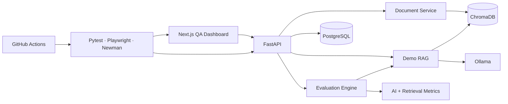

# EvalGuard

EvalGuard is an AI and RAG quality-assurance framework. It evaluates a local document-grounded assistant with traditional API and browser tests plus metric-based checks for retrieval, generation, hallucination, citations, consistency, regression, and latency.

The bundled RAG service is the system under test; the evaluation engine, evidence, and release gates are the main product.

## What it solves

Traditional assertions can prove that an endpoint returned `200`, but they cannot prove that a non-deterministic answer is relevant, correct, or supported. EvalGuard records both kinds of evidence and distinguishes failures such as:

- correct context with a wrong answer → **Generation Failure**
- expected source missing from retrieval → **Retrieval Failure**
- unsupported factual claim → **Hallucination**
- invalid or missing citations → **Citation Failure**
- slow end-to-end execution → **Latency Failure**
- unsafe response to injected instructions → **Prompt Injection Failure**

## Features

- PDF, Markdown, and text upload with size/type validation and Chroma indexing
- Ollama generation (`llama3.1:8b`) with local sentence-transformer embeddings
- pluggable LLM, embedding, and vector-store provider boundaries
- datasets and purposeful factual, retrieval, missing-context, adversarial, consistency, latency, and regression cases
- structured relevance, faithfulness, context precision/recall, correctness, hallucination, citation, and consistency metrics
- Hit Rate@K, Precision@K, Recall@K, and MRR retrieval evaluation
- configurable release thresholds with exact failed-gate evidence
- run history, test evidence, unsupported claims, failure filters, and baseline comparison
- real dashboard summaries and trends calculated from persisted runs
- deterministic providers for CI-safe AI QA without model downloads
- Pytest API/regression coverage, Playwright critical flows, and a Newman-compatible collection
- PostgreSQL migrations, 25-case demo seed, Docker Compose, and GitHub Actions gates

## Architecture



## Stack

Python 3.12, FastAPI, Pydantic, SQLAlchemy 2, PostgreSQL, Alembic, LangChain, Ollama, ChromaDB, sentence-transformers, RAGAS, Pytest, HTTPX, Next.js App Router, TypeScript, Tailwind CSS, Recharts, Playwright, Newman, Docker, and GitHub Actions.

The production provider mode is fully local and requires no paid API.

## Quick start

### Prerequisites

- Python 3.12
- Node.js 22 and pnpm
- PostgreSQL 16
- Ollama

Copy `.env.example` to `.env`, then adjust connection paths if needed.

```bash
python -m venv .venv
source .venv/bin/activate          # Windows: .venv\Scripts\activate
pip install -e ".[dev,local-ai]"
docker compose up -d postgres
alembic -c backend/alembic.ini upgrade head
```

### Ollama setup

```bash
ollama serve
ollama pull llama3.1:8b
```

Ollama can alternatively be started from Compose:

```bash
docker compose --profile local-ai up -d ollama
```

### Seed the demonstration

```bash
python -m backend.scripts.seed
```

This indexes the fictional employee handbook and creates one versioned grounded-QA prompt, the default quality gates, and 25 evaluation cases. Running the command again is safe; it does not duplicate the dataset.

### Run the application

Terminal 1:

```bash
uvicorn backend.app.main:app --reload
```

Terminal 2:

```bash
cd frontend
pnpm install
pnpm dev
```

Open [http://localhost:3000](http://localhost:3000). API documentation is available at [http://localhost:8000/docs](http://localhost:8000/docs).

To run the application services in containers instead:

```bash
docker compose up --build
```

Ollama normally runs on the host so its model cache and hardware acceleration can be managed independently.

## Quality metrics

| Metric | Default gate | Purpose |
| --- | ---: | --- |
| Faithfulness | ≥ 0.85 | Answer claims supported by retrieved context |
| Answer relevance | ≥ 0.80 | Answer addresses the question/reference |
| Context precision | ≥ 0.80 | Retrieved chunks relevant to the target |
| Context recall | ≥ 0.80 | Expected facts covered by retrieved context |
| Answer correctness | ≥ 0.80 | Generated output covers the reference answer |
| Hallucination rate | ≤ 0.05 | Unsupported claim rate |
| Retrieval hit rate | ≥ 0.90 | Expected source appears in top K |
| Citation validation | ≥ 1.00 | Citations resolve to returned chunks |
| Consistency | ≥ 0.80 | Repeated answers remain semantically aligned |
| P95 latency | ≤ 3000 ms | End-to-end tail latency |

Scores are stored per case with their threshold and explanation. Run summaries retain averages, min/max, P50/P95 latency, retrieval metrics, and the exact gates that failed.

## Example evaluation evidence

```json
{
  "question": "How many annual leave days do employees receive?",
  "expected_answer": "25 days",
  "actual_answer": "Employees receive 30 annual leave days per year [1].",
  "retrieval_hit_rate": 1.0,
  "answer_correctness": 0.5,
  "status": "failed",
  "failure_type": "Generation Failure"
}
```

The deterministic regression suite also covers a wrong-document retrieval failure and an unsupported claim about the CEO's family.

## Test commands

```bash
# all deterministic backend tests
pytest

# focused suites
pytest -m api
pytest -m regression
pytest -m ai

# backend lint gate
ruff check backend tests

# frontend build
cd frontend && pnpm build

# critical browser flows (install Chromium once)
pnpm exec playwright install chromium
pnpm test:e2e

# Newman API contracts, with the backend running
cd ..
npm install
npm run test:postman
```

`make dev`, `make test`, `make test-api`, `make test-ai`, `make test-regression`, `make lint`, `make migrate`, and `make seed` provide root-level shortcuts on systems with Make.

## CI/CD

`.github/workflows/ci.yml` enforces three independent gates:

1. backend lint plus deterministic API/AI tests with coverage;
2. frontend production build plus Playwright browser workflows;
3. Newman contracts against a migrated PostgreSQL database and deterministic providers.

Model-dependent local evaluation stays outside the CI-safe path. The pipeline does not download an Ollama model or sentence-transformer weights.

## API surface

- `POST/GET /api/v1/documents`, document detail/delete, and `POST /documents/{id}/index`
- `POST /api/v1/rag/query`
- dataset and test-case CRUD under `/api/v1/datasets` and `/api/v1/test-cases`
- prompt versions and quality gates under `/api/v1/prompts` and `/api/v1/quality-gates`
- `POST/GET /api/v1/evaluation-runs`
- `GET /api/v1/evaluation-runs/{id}/results`
- `GET /api/v1/evaluation-runs/{id}/compare/{baseline_id}`
- `GET /api/v1/dashboard`

Errors use a stable envelope:

```json
{
  "error": {
    "code": "INVALID_DOCUMENT",
    "message": "Only PDF, TXT, and Markdown files are supported."
  }
}
```

## Project structure

```text
backend/
  alembic/              database migration environment and initial schema
  app/
    api/                HTTP routes and dependency wiring
    core/               settings, errors, structured logging
    db/                 async session and declarative base
    evaluation/         retrieval metrics and failure classification
    evaluators/         metric abstraction and implementations
    models/             persisted domain entities
    providers/          Ollama/Chroma/local embeddings and deterministic fakes
    schemas/            request and response contracts
    services/           document, RAG, and evaluation orchestration
  data/demo/            fictional employee handbook
  scripts/seed.py       repeatable 25-case demo setup
frontend/
  app/                  dashboard routes
  components/           navigation, charts, and shared UI
  tests/e2e/            critical Playwright workflows
postman/                Newman-compatible API collection
tests/                  Pytest API and AI regression suites
```

## Screenshots

Capture the dashboard overview, a failed hallucination detail, and a baseline comparison after running the seeded suite. Keeping screenshots generated from a real local run avoids publishing fabricated metrics.

## Development status

- [x] Project structure, typed configuration, entities, and initial migration
- [x] Document ingestion and indexing
- [x] Provider-based RAG pipeline with latency/source telemetry
- [x] Dataset, test-case, prompt, run, and quality-gate APIs
- [x] AI and retrieval evaluation, failure classification, and run comparison
- [x] Real-data dashboard and failed-test evidence view
- [x] 25-case demo knowledge base and seed command
- [x] Pytest, Playwright, Newman, Docker, and CI quality gates

## Future improvements

- calibrated LLM-judge adapters with evaluator/model provenance
- asynchronous queue execution for very large datasets
- exportable JSON/JUnit quality reports
- production object storage for uploaded documents
- longitudinal alerting integrations for quality regressions

